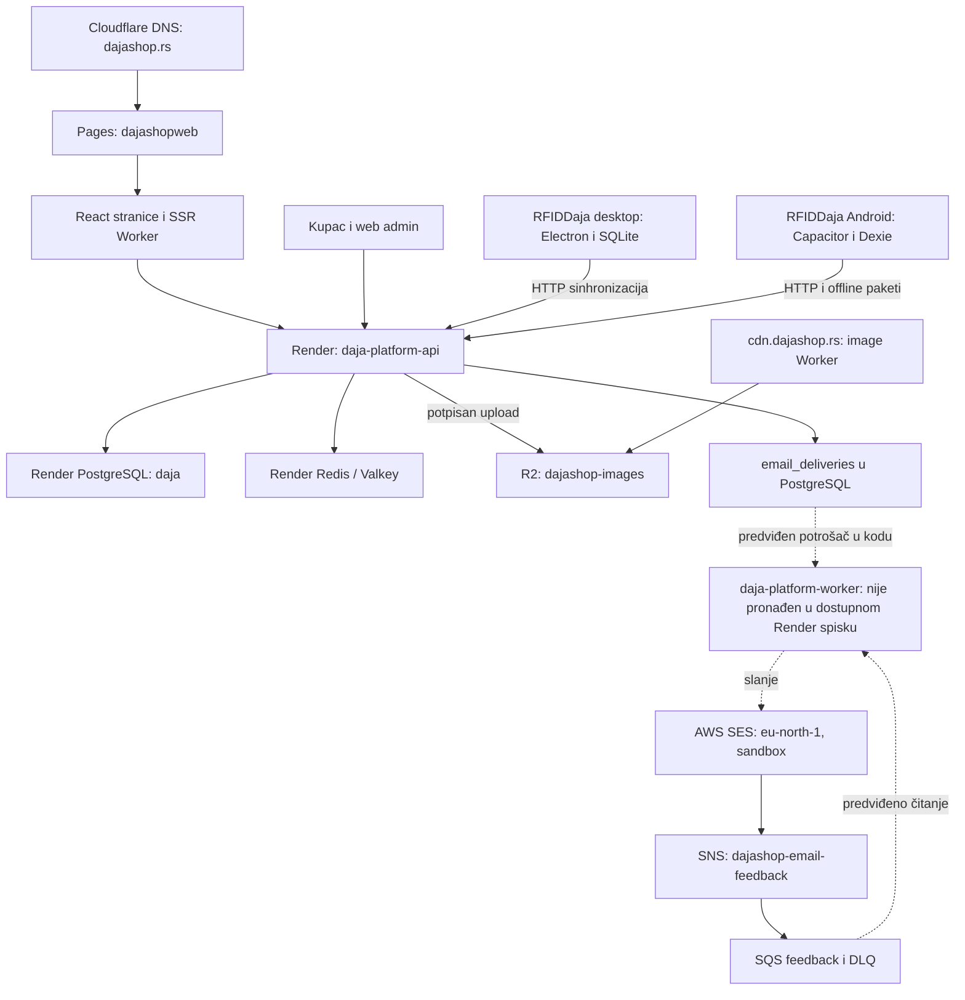

# DAJA — mapa infrastrukture i veza

Pregled: 28.10.2026, Europe/Belgrade. Izvori: uspešni read-only pozivi Render, Cloudflare i AWS konektora, PostgreSQL SELECT nad šemom i zbirnim email stanjem, lokalni izvorni kod i odabrana javna podešavanja. Ovo je snimak stanja, ne potvrda rada svih funkcija.

Tokom izvornog pregleda nisu menjani kod, infrastruktura, DNS, tajne, baze ni podešavanja. Nisu pokretani testovi, aplikacije, migracije, slanje mejlova ili instalacija na Android. Nije proveravan završetak deploya. Korisnik je zatim zatražio da mapa bude sačuvana i u sva tri repozitorijuma: ovaj dokument je ta verzija podsetnika, a korenski AGENTS.md i README vode do njega. Ova dokumentaciona dopuna ne potvrđuje novu produkcijsku konfiguraciju.

## Kako koristiti ovaj podsetnik

Prvo pročitaj ovu mapu kada zadatak uključuje više DAJA projekata ili cloud servise. Izvori i ID-jevi ispod pomažu da pronađeš odgovarajući resurs; proveri njegovo trenutno stanje samo kada je to potrebno za zadatak. Kada menjaš samu mapu zajedničkih veza, uskladi kopije docs/INFRASTRUCTURE.md u sva tri repozitorijuma. Za trenutno stanje koda koristi datoteke koje zaista postoje u checkoutu, a datum pregleda ne predstavljaj kao današnju proveru.

## Kako je povezano

Pune strelice prikazuju potvrđene konfiguracione veze ili veze u izvorima. Isprekidane označavaju deo koji postoji u kodu, čije pokretanje na Renderu ovim pregledom nije potvrđeno. Dijagram ne predstavlja izvršen funkcionalni test.

## Repozitorijumi i vlasništvo nad kodom

| Projekat | Lokalni direktorijum | GitHub | Lokalni HEAD tokom pregleda |
|---|---|---|---|
| RFID desktop / Android / PWA | `C:\Users\09081\Desktop\RFIDDaja` | `DareGamesOO4/RFIDDaja` | `326a0ba` |
| Zajednički backend | `C:\Users\09081\Desktop\daja-platform` | `DareGamesOO4/daja-platform` | `e18f9af` |
| Prodavnica i web admin | `C:\Users\09081\Desktop\dajashopweb` | `dajashop/dajashopweb` | `377b6ab` |

Sva tri lokalna checkouta su na grani `main`. HEAD je lokalni podatak; nije utvrđivano koja se revizija trenutno izvršava u cloudu. Nisu pronađeni lokalni AGENTS.md u pretraženim projektima; važe korisnikova uputstva iz razgovora.

Tokom izvornog pregleda zatečene promene ostale su netaknute: RFID `apps/mobile/.idea/caches/deviceStreaming.xml` i web `.env.example`. Backend je bio čist. Naknadna dopuna repozitorijuma obuhvata samo ovu mapu, AGENTS.md i README veze; ona ne menja ponašanje sistema.

## Render — potvrđeno na nalogu

Workspace: **Dejan's workspace**, nalog `dajashopnis@gmail.com`, ID `tea-d9vm88ojo6nc73aq8fag`. Resursi ispod dele environment ID `evm-da06q9m7bikc73egt4fg` i region Frankfurt.

| Resurs | ID / adresa | Uloga i konfiguracija |
|---|---|---|
| `daja-platform-api` | `srv-da06vne7bikc73eh7h40`; `https://daja-platform-api.onrender.com` | Jedini servis vraćen u dostupnom spisku. Repo `DareGamesOO4/daja-platform`, grana `main`, automatski deploy na commit. Docker: `./apps/api/Dockerfile`. Plan `0.5c-512mb`, jedna instanca. Health putanja `/health/ready`. |
| `daja-platform-postgres` | `dpg-da06q9gjo6nc73ds1gjg-a` | PostgreSQL 18, baza `daja`, plan `0.1c-256mb`, disk 1 GB. Bez HA i read replica; autoscaling diska isključen. Connection pool: `none`. |
| `daja-platform-redis` | `red-da073mmgekts7399hu7g` | Valkey/Redis kompatibilan servis 8.1.4, free plan, `noeviction`, persistence `off`; koristi se za redove i povezane backend funkcije prema kodu. |

PostgreSQL metadata SELECT vratio je 124 osnovne tabele. Grupišu se u katalog i medije; korisnike, prava i sesije; kupce, korpu, porudžbine i promocije; RFID, stanje i lokacije; sinhronizaciju, offline pakete i konflikte; saglasnosti, newsletter i email outbox. Nisu čitani podaci kupaca ili sadržaj porudžbina.

**Bitna razlika između koda i vidljivih resursa:** `render.yaml` definiše `daja-platform-worker`, ali dostupni `list_services` nije ga vratio. Tabele `email_worker_health` i `email_deliveries` su tokom SELECT pregleda bile prazne. To nije dokaz da mejlovi funkcionišu, niti konačan dokaz da worker ne postoji negde van obuhvata ovog konektora. Ne pretpostavljati da je produkcijsko slanje završeno samo zato što kod postoji.

Render konektor u ovom trenutku nudi izmenu env promenljivih, ali nema namenski read alat za njihove vrednosti. Produkcijske vrednosti `DATABASE_URL`, `REDIS_URL`, SES i R2 tajni, javne organizacije i signing tajne zato nisu potvrđene. Zajednički environment i odgovarajuća šema nisu dokaz tačne vrednosti env veza API-ja.

## Cloudflare — potvrđeno na nalogu

Account: **Dajashopnis@gmail.com's Account**, ID `10bd3bdfe4417a769f8efd8d3f54bc74`. Zona `dajashop.rs`: `14941bb3ea06a7d1ff0db8e99533f328`, status `active`.

| Resurs | Veza | Konfiguracija |
|---|---|---|
| Pages `dajashopweb` | `dajashop.rs`, `dajashopweb.pages.dev` | GitHub `dajashop/dajashopweb`, produkcijska grana `main`; `npm run build`, izlaz `dist`; Functions uključen. ID `ae3657bc-8ae9-4c69-b273-4cdbccf2c4ec`. |
| Pages `dajashop` | `dajashop.pages.dev` | Isti GitHub repo, produkcijska grana ovog projekta je `staging/daja-platform-api`; isti build i izlaz. ID `7bee3ced-2871-4d31-98f0-6a60ff101a8f`. Sam naziv polja production ne znači da ovaj projekat služi glavni domen. |
| Worker `dajashop-r2-image-worker-production` | Custom domain `cdn.dajashop.rs` | Jedini zaseban Worker u vraćenom spisku; handler `fetch`, bez cron rasporeda. Binding `DAJASHOP_IMAGES` → `dajashop-images`. Postoji secret binding `R2_AUTH_TOKEN`; vrednost nije čitana niti sačuvana. |
| R2 `dajashop-images` | Slike i mediji | Jedini bucket u vraćenom spisku. Nema direktan R2 custom domain: CDN domen pripada Workeru. CORS dozvoljava PUT sa `dajashop.rs`, `www.dajashop.rs`, `dajashop.pages.dev`, uz `Content-Type`; izlaže ETag. |

Pages `dajashopweb` ima potvrđene produkcijske vrednosti:

- `DAJA_API_BASE_URL=https://daja-platform-api.onrender.com/api/v1` za SSR runtime.
- `VITE_DAJA_API_BASE_URL=https://daja-platform-api.onrender.com/api/v1` za browser build.
- Postoji `VITE_DAJA_WS_URL`; njegova vrednost ovim pozivom nije izložena. Postoje poslovni/SEO podaci, Google Maps, Analytics i admin email konfiguracioni nazivi. Ključevi i tokeni nisu kopirani u podsetnik.
- Oba projekta imaju prazne preview env liste u vraćenom podešavanju. U `dajashop` production env spisku vraćen je samo `VITE_ADMIN_EMAILS`; stvarno ponašanje tog staging sajta nije proveravano.

Vraćeni inventari D1, Queues, Hyperdrive i KV su prazni. Cloudflare Email Routing je `enabled=false`, status `unconfigured`. Nema potvrđenog Cloudflare sistema koji preuzima nove porudžbine i šalje email kada Render nije dostupan. Pages SSR funkcija nije prikazana kao zaseban Worker u Workers spisku; vidi se kroz Pages `uses_functions` i lokalni build.

### DNS i HTTP podešavanja

- Apex `dajashop.rs` je proxied CNAME na `dajashopweb.pages.dev`.
- `www` i wildcard imaju dodatne proxied A zapise `194.9.94.85` i `194.9.94.86`.
- U Cloudflare dynamic redirects postoji uključeno pravilo 301 sa HTTPS `www.*` na adresu bez `www`, uz očuvanje query stringa. Zato sama A vrednost za www ne opisuje krajnje odredište zahteva.
- Standardni Worker routes spisak i Page Rules spisak su prazni. `cdn` je povezan zasebnim Worker Custom Domain podešavanjem.
- `always_use_https=on`, `automatic_https_rewrites=on`, `ssl=full`, `min_tls_version=1.0`, `security_level=medium`, `browser_check=on`, HTTP/3 i Brotli uključeni; `cache_level=aggressive`.
- SSL mode i minimum TLS su zabeleženi kao zatečeno stanje. Ništa nije menjano i nije rađen bezbednosni ili TLS test. Prisustvo managed rulesetova u inventaru samo po sebi nije potvrda pojedinačne primene svakog pravila.

## Ponašanje prema izvorima

### Sajt

`dajashopweb` koristi React/Vite. `scripts/build.mjs` pravi browser assets i `dist/_worker.js` iz `src/ssr/worker.js` za Pages advanced mode. SSR učitava javni katalog iz Render API-ja, a `/sitemap.xml` i `/merchant-feed.xml` prosleđuje backendu. Privatne stranice i email linkovi imaju posebne cache/robots politike u kodu. Ovo nije nezavisna kopija poslovnog backenda.

Browser API klijent `src/services/apiClient.js` podrazumevano koristi Render `/api/v1`. Kreiranje porudžbine je POST `/orders` u `src/services/dajaPlatform.js`; u pregledanom toku nema Cloudflare rezervne predaje. Socket.IO koristi `/realtime` na API originu. Admin, kupci, katalog, porudžbine i mediji dele ovaj backend.

Za upload slika browser prvo traži potpisan upload kroz `/media/uploads`, radi PUT na vraćenu adresu, pa prijavljuje završetak. Backend kod čuva metapodatke u PostgreSQL, koristi R2 S3 API, a worker kod obrađuje izvedene slike. Lokalni `MEDIA_PUBLIC_BASE_URL` je `https://cdn.dajashop.rs/images`; ovo nije pročitana vrednost Render produkcijskog env-a.

### Desktop i Android

`RFIDDaja` desktop je Electron aplikacija. `src/main/index.ts` otvara lokalnu SQLite bazu `daja-shop-rfid.sqlite`, formira `HttpCloudClient` i uključuje sync transport kada je omogućen. Lokalni `.env` ima `DAJA_SYNC_ENABLED=1`, isti Render API i organization ID `00000000-0000-4000-8000-000000000101`. Ove vrednosti se odnose na ovaj checkout, ne na svaki instalirani uređaj.

`src/main/local-runtime/network/http-cloud-client.ts` koristi `/auth`, `/sync/push`, `/sync/pull`, `/sync/bootstrap`, offline inventuru i medije. Lokalni sync worker obrađuje `sync_outbox`, retry/backoff, server revision i konflikte. U backendu `sync.controller.ts` koristi `OperationalSyncProjector` i objavljuje promene kataloga/realtime događaje. Time promene iz aplikacije mogu da stignu u zajednički model koji čita sajt, uz validacije i dozvole.

Android je Capacitor aplikacija `rs.dajashop.modernrfid` / Modern RFID. `apps/mobile/src/cloud/mobile-platform-client.ts` ima isti podrazumevani Render API; koristi prijavu, `/sync/bootstrap` i potpisane offline inventurne pakete. `apps/mobile/src/offline/mobile-repository.ts` koristi Dexie/IndexedDB. Native RFID sloj je u `packages/rfid-mobile`; desktop ima TCP, YRM100 serial i ESP32/Wi-Fi adaptere. Stvarna povezanost čitača, telefona i sinhronizacija nisu proveravane.

U RFID repozitorijumu postoje i `apps/web` PWA i `apps/server` izvori. Njihovo prisustvo ne znači da je taj zasebni Node server trenutno postavljen na Render; u dostupnom Render inventaru vidi se `daja-platform-api` iz drugog repozitorijuma.

## Email i AWS veza

Potvrđeno za SES `eu-north-1`: slanje omogućeno, stanje `HEALTHY`, `ProductionAccessEnabled=false` — **sandbox je nameran zahtev korisnika**. Kvota u trenutku čitanja: 200/24h, 1/s. `dajashop.rs` i DKIM su uspešno potvrđeni; MAIL FROM `bounce.dajashop.rs` je uspešan.

DNS ima tri SES DKIM CNAME zapisa, `bounce.dajashop.rs` MX ka `feedback-smtp.eu-north-1.amazonses.com`, SPF `v=spf1 include:amazonses.com -all` na bounce poddomenu, apex SPF `v=spf1 -all`, DMARC `v=DMARC1; p=reject; sp=reject; adkim=s; aspf=r;`.

Configuration set `my-first-configuration-set` šalje BOUNCE, COMPLAINT, DELIVERY, DELIVERY_DELAY, REJECT i RENDERING_FAILURE u uključen SNS destination `dajashop-feedback` → topic `arn:aws:sns:eu-north-1:877348951940:dajashop-email-feedback`. Potvrđena SQS pretplata ima RawMessageDelivery=true. Glavni SQS red `dajashop-email-feedback` vodi u `dajashop-email-feedback-dlq` posle 5 neuspešnih prijema; oba čuvaju poruke 14 dana. Nisu preuzimane poruke iz redova.

U kodu API upisuje `email_deliveries` kroz `EmailDeliveryService`; posebni Node worker šalje preko SES i obrađuje SQS feedback. Njegov start zahteva Redis, PostgreSQL i migracije, a isti proces ima BullMQ/media poslove. To nije postojeći Cloudflare image Worker. `CONTACT_NOTIFICATION_EMAIL` u `render.yaml` je `cvelenis42@yahoo.com`; definisani pošiljaoci su `nalog@dajashop.rs` i `porudzbine@dajashop.rs`. Produkcijske Render vrednosti nisu proverene.

## Šta sledeći put prvo pogledati

1. Za sajt/SSR: Pages projekat **dajashopweb**, zatim `dajashopweb/scripts/build.mjs`, `src/ssr/worker.js`, `src/services/apiClient.js`.
2. Za zajedničke podatke: Render API i `daja-platform/apps/api/src`; PostgreSQL sadrži zajedničku šemu, Redis služi pozadinskim funkcijama prema kodu.
3. Za desktop/Android: `RFIDDaja/src/main/index.ts`, `src/main/local-runtime/network/http-cloud-client.ts`, `apps/mobile/src/cloud/mobile-platform-client.ts` i oba lokalna skladišta.
4. Za slike: R2 bucket + Worker Custom Domain `cdn.dajashop.rs`; `dajashopweb/wrangler.toml` opisuje image Worker, ne Pages i ne email fallback.
5. Za mejlove: prvo utvrditi gde se izvršava consumer `daja-platform-worker`; ne pretpostavljati spremno slanje na osnovu `render.yaml` ili praznog outboxa. SES ostaviti u sandboxu dok korisnik ne traži drugačije.
6. Za budući Render → Cloudflare fallback: trenutno postoji samo dogovorena ideja. Potrebni su zaseban trajan rezervni zahtev i jedinstveni request ID koji poštuju oba puta. Izostao Render odgovor nije dokaz da porudžbina nije već upisana. Ne tretirati browser cene/zalihe kao potvrđene niti zaobilaziti poslovne validacije.

Identifikatori, endpointi i nalazi su snimak stanja od 28.10.2026. Pre kasnijih izmena ponovo pročitati odgovarajući resurs. Lozinke, pristupni ključevi i vrednosti tajni nisu deo ove mape.
